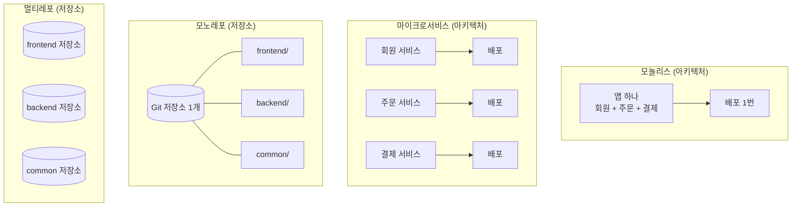

---
별칭:
  - 학습 - 모놀리스와 모노레포
  - Monolith
  - Monorepo
tags:
  - type/study
  - context/studies
  - theme/dev
  - status/in-progress
생성일: 2026-11-13
수정일: 2026-11-13
출처: 
주제:
  - "[[00 - 대시보드/주제/소프트웨어 설계|소프트웨어 설계]]"
---

# 학습: 모놀리스와 모노레포

## 핵심 요약
> **모놀리스(Monolith)** 는 앱을 **어떻게 만들고 배포하느냐**(아키텍처)의 이야기이고, **모노레포(Monorepo)** 는 코드를 **어떻게 저장하느냐**(저장소 전략)의 이야기다. 이름이 비슷하지만 서로 독립된 개념이라 섞어서 쓸 수 있다.

## 세부 내용

### 1. 모놀리스 (Monolithic Architecture)
- 모든 기능(회원, 주문, 결제 등)을 **하나의 애플리케이션**으로 만들고 **통째로 빌드·배포**하는 구조.
- 예: Spring Boot 프로젝트 하나를 jar/war 하나로 만들어 서버에 올리는 방식.
- 반대 개념: **마이크로서비스(MSA)**. 기능별로 서비스를 쪼개 각각 따로 배포한다.

| 구분 | 모놀리스 | 마이크로서비스 |
|---|---|---|
| 배포 단위 | 앱 전체 하나 | 서비스마다 따로 |
| 장점 | 구조가 단순, 개발·테스트·디버깅이 쉬움, 서비스 간 네트워크 호출 없음 | 서비스별 독립 배포·확장, 한 서비스 장애가 전체로 번지는 것을 줄일 수 있음, 팀별 독립 개발 |
| 단점 | 작은 수정도 전체 재배포, 규모가 커지면 코드가 얽히기 쉬움, 일부만 확장하기 어려움 | 운영 복잡도 증가(배포·모니터링·네트워크), 서비스 간 데이터 일관성 관리가 어려움 |

### 2. 모노레포 (Monorepo)
- 여러 프로젝트(예: 프론트엔드, 백엔드, 공통 라이브러리)를 **Git 저장소 하나**에 함께 두는 방식.
- 반대 개념: **멀티레포(폴리레포, Polyrepo)**. 프로젝트마다 저장소를 따로 만든다.
- 대표 도구: **Nx, Turborepo, Lerna**(JavaScript/TypeScript), **Bazel**, **Gradle 멀티 프로젝트**(Java).
- 예: Google, Meta 같은 대형 회사는 회사 코드 대부분을 거대한 모노레포 하나로 관리한다.

| 구분 | 모노레포 | 멀티레포 |
|---|---|---|
| 저장소 | 하나 | 프로젝트마다 하나 |
| 장점 | 공통 코드 공유가 쉬움, 여러 프로젝트에 걸친 변경을 커밋 하나로 처리, 도구·설정 통일 | 저장소가 작고 가벼움, 프로젝트별 권한·배포 분리가 쉬움 |
| 단점 | 저장소가 커지면 빌드·클론이 느려짐(전용 도구 필요), 권한 분리가 어려움 | 공통 코드 버전 맞추기 번거로움, 여러 저장소에 걸친 변경이 어려움 |

### 3. 둘의 관계: 독립된 축
| | 모노레포 | 멀티레포 |
|---|---|---|
| **모놀리스** | 앱 하나 + 저장소 하나 (가장 흔한 작은 프로젝트) | 앱은 하나지만 모듈별 저장소 분리 (드묾) |
| **마이크로서비스** | 여러 서비스를 저장소 하나에서 관리 | 서비스마다 저장소 따로 (흔한 MSA 구성) |

- 즉 "모노레포 = 모놀리스"가 **아니다**. 마이크로서비스 여러 개를 모노레포 하나에 둘 수도 있다.

### 4. 그림으로 비교

## 관련 노트
- [[00 - 대시보드/주제/소프트웨어 설계|소프트웨어 설계]]
