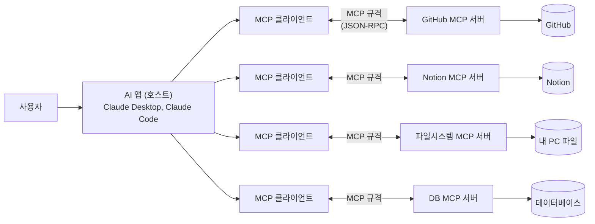
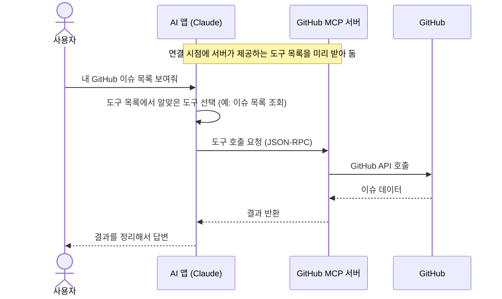

---
별칭:
  - 학습 - MCP 서버
  - Model Context Protocol
tags:
  - type/study
  - context/studies
  - theme/dev
  - status/in-progress
생성일: 2026-11-13
수정일: 2026-11-13
출처:
  - https://modelcontextprotocol.io
주제:
  - "[[00 - 대시보드/주제/개발 도구|개발 도구]]"
---

# 학습: MCP 서버

## 핵심 요약
> **MCP 서버**는 AI 앱(Claude 같은 LLM 기반 앱)이 외부 도구나 데이터에 접근할 수 있도록 기능을 노출하는 프로그램이다. MCP(Model Context Protocol)는 Anthropic이 2024년 11월에 공개한 오픈 프로토콜이다.

## 세부 내용

### 1. 구성 요소
| 구성 | 역할 | 예시 |
|---|---|---|
| 호스트(Host) | 사용자가 쓰는 AI 앱 | Claude Desktop, Claude Code |
| 클라이언트(Client) | 호스트 안에서 MCP 서버 하나와 1:1로 연결을 맺는 부분 | - |
| 서버(Server) | 특정 기능·데이터를 노출하는 프로그램 | GitHub, Notion, 파일시스템, DB 서버 |

### 2. 통신 방식
- 메시지 형식: **JSON-RPC 2.0**
- 전송 방식(transport)
  - **stdio**: 로컬 서버. 호스트가 서버 프로세스를 직접 실행하고 표준 입출력으로 통신
  - **HTTP(Streamable HTTP)**: 원격 서버. 네트워크로 연결

### 3. 서버가 제공하는 것 3가지
1. **Tools**: AI가 호출하는 함수 (예: 이슈 생성, 쿼리 실행)
2. **Resources**: AI가 읽는 데이터 (파일, 문서 등)
3. **Prompts**: 재사용 가능한 프롬프트 템플릿

### 4. 왜 쓰나
- 예전에는 AI 앱마다 서비스별 연동을 따로 만들어야 했다.
- MCP 서버를 한 번 만들면 **MCP를 지원하는 모든 AI 앱**에서 재사용할 수 있다.
- 그래서 흔히 **"AI용 USB-C"** 에 비유한다.

### 5. Claude Code에서 연결하는 법 (요약)
```powershell
# 원격(HTTP) 서버
claude mcp add --transport http <이름> <URL>
# 로컬(stdio) 서버
claude mcp add --transport stdio <이름> -- npx -y <패키지>
# 목록 확인
claude mcp list
```
자세한 내용은 [[02 - 학습/IT/개인공부/클로드/10-MCP-서브에이전트-훅|10. MCP, 서브에이전트, 훅]] 참고.

## 그림으로 이해하기

### 1. 쉬운 비유: 만능 어댑터
- **AI 앱** = 노트북
- **MCP** = USB-C 같은 공통 규격
- **MCP 서버** = 각 기기(GitHub, Notion, 파일, DB)에 붙는 USB-C 어댑터

노트북은 기기마다 다른 케이블을 몰라도 USB-C 하나로 연결한다. 마찬가지로 AI 앱은 서비스마다 연동 코드를 따로 만들 필요 없이, MCP 규격만 알면 어떤 MCP 서버든 붙여 쓸 수 있다.

### 2. 전체 구조

- 호스트 안의 클라이언트는 서버 **하나와 1:1**로 연결된다.
- 서버는 실제 서비스(GitHub API, DB 등)와 AI 앱 사이의 **통역사** 역할을 한다.

### 3. 요청 흐름 (예: "내 GitHub 이슈 목록 보여줘")

- AI가 직접 GitHub에 접속하는 게 아니라, **MCP 서버가 대신 호출**하고 결과만 돌려준다.
- 어떤 도구를 쓸지는 **AI(모델)가 판단**하고, 앱 설정에 따라 실행 전에 사용자 승인을 받기도 한다.

## 관련 노트
- [[02 - 학습/IT/개인공부/클로드/클로드|클로드 로드맵]]
- [[02 - 학습/IT/개인공부/클로드/10-MCP-서브에이전트-훅|10. MCP, 서브에이전트, 훅]]
