---
별칭:
  - "업무 - Untitled"
태그:
  - type/work-doc
  - context/work
  - theme/dev
  - status/completed
생성일: 
수정일: 2026-11-04
프로젝트: "[[03 - 프로젝트/보관함/전기차 충전 플랫폼/전기차 충전 플랫폼 (2023.07~2024.08)|전기차 충전 플랫폼 (2023.07~2024.08)]]"
노션원본: https://www.notion.so/7ef2a4d1e8eb4d33bc1fc8d54a7b5e1e
---

# 업무: Untitled

## 내용

```mermaid
sequenceDiagram
%%{
  init: {
    'theme': 'base',
    'themeVariables': {
      'primaryColor': '#eeeeee',
      'primaryTextColor': '#999',
      'primaryBorderColor': '#aaa',
      'noteBkgColor':'#771188',
      'noteTextColor':'#fff',
      'background':'#771188',
      'lineColor': '#fff',
      'secondaryColor': '#77118899',
      'fontSize':'30px',
      'signalColor':'#771188',
     'loopBorderColor':'#ff5555',
     'labelBoxBorderColor':'#771188',
     'labelBoxBkgColor':'#771188',
      'tertiaryColor': '#771188'
   }
  }
}%%

    autonumber
    actor EV
    participant CS
    participant WS
    participant API
    Note over EV: 앱 결제 완료
    
    activate API
    EV ->> API: 원격 충전 요청
    API ->>+ WS: 메세지 전달<br/>RemoteStartTransactionRequest
    WS ->>+ CS: 원격 충전 시작 요청<br/>RemoteStartTransactionRequest<br/>(idTag,[connectorId],[chargingProfile])
    CS -->>- WS: 원격 충전 시작 응답 <br/>RemoteStartTransactionResponse<br/>(Accepted)
    WS -->>- API: 메세지 전달<br/>RemoteStartTransactionResponse
    deactivate API
%% 권한 인증
    CS ->>+ WS: 충전기 권한 인증 요청 <br/>AuthorizeRequest(idTag)
    WS ->>+ API: 메세지 전달<br/>AuthorizeRequest
    API ->> DB: 권한 조회
    API ->> API: 권한 체크
    API -->>- WS: 메세지 전달<br/>AuthorizeResponse
    WS -->>- CS: 충전기 권한 인증 응답 <br/>AuthorizeResponse
    CS ->> EV: 커넥터 연결 요청
    
    alt if: 커넥션 타임아웃 이내 커넥터 연결
    EV ->> CS: 커넥터 연결
%% StatusNotification(충전기 상태 알림)
    Note over CS, DB: 충전기 상태 알림 요청 <br/>StatusNotificationRequest(Preparing)
    else else: 커넥터 타임아웃 이후
    Note over CS, DB: 원격 충전 중지 요청 및 응답 <br/>RequestStopTransaction <br/>(결제 취소 및 주문 정보 업데이트)
    end
%%  StartTransaction(충전 시작)
    CS ->>+ WS: 충전 시작 요청<br/> StartTransactionRequest
    WS ->>+ API: 메세지 전달 <br/>StartTransactionRequest
    API ->> DB: 주문 정보 조회
    API ->> DB: 충전 요금 조회
    API ->> API: 충전 세션 생성
    API ->> DB: 충전 세션 등록
    API -->>- WS: 메세지 전달<br/>StartTransactionResponse
    WS -->>- CS: 충전 시작 응답<br/>StartTransactionResponse
%% StatusNotification(충전기 상태 알림)
    Note over CS, DB: 충전기 상태 알림 요청 <br/>StatusNotificationRequest(Charging)
    CS ->>+ WS: 충전 단가 요청<br/>DataTransfer(getPrice) Request
    Note over CS, DB: 충전 단가 요청 :단가 정보를 가져오기 위한 메시지 <br/>DataTransfer(getPrice)
    WS -->>- CS: 충전 단가 응답<br/>DataTransfer(getPrice) Response

    loop 충전 진행 상황 업데이트
        CS ->>+ WS: 미터 값 요청<br/> MeterValueRequest
        WS ->>+ API: 메세지 전달 <br/> MeterValueRequest
        API ->> DB: 충전 세션 정보 업데이트(가격, 충전량)
        API ->> API: 충전 상태 체크
        API -->> WS: 메세지 전달<br/> MeterValueResponse
        WS -->>- CS: 미터 값 응답<br/> MeterValueResponse
    end

    alt if 결제된 금액보다 충전 금액이 큰 경우
        API ->>+ WS: 메세지 전달<br/>RemoteStopTransactionRequest
        WS ->>+ CS: 원격 충전 중지 요청<br/>RemoteStopTransactionRequest<br/>(idTag,[connectorId],[chargingProfile])
        activate CS
        CS -->> - WS: 원격 충전 중지 응답 <br/>RemoteStopTransactionResponse<br/>(Accepted)
        WS -->>- API: 메세지 전달<br/>RemoteStopTransactionResponse
        deactivate API
        CS ->>+ WS: 충전 중지 요청<br/> StopTransactionRequest
        WS ->>+ API: 메세지 전달 <br/> StopTransactionRequest
        API ->> DB: 충전세션 정보 업데이트(가격, 충전량)
        Note over API: 충전 후처리<br/>1. 충전량 계산<br/>2. 주문 테이블 상태 완료, 계산 완료, 요금 업데이트<br/>3. 충전 진행 세션 테이블 삭제<br/>4. 충전 내역 추가
        API -->>- WS: 메세지 전달<br/> StopTransactionResponse
        WS -->>- CS: 충전 중지 응답<br/> StopTransactionResponse

    else else
    %% StatusNotification(충전기 상태 알림)
        Note over CS, DB: 충전기 상태 알림 요청 <br/>StatusNotificationRequest(Finishing)
    %% StopTransaction(충전 중지)
        CS ->>+ WS: 충전 중지 요청<br/> StopTransactionRequest
        WS ->>+ API: 메세지 전달 <br/> StopTransactionRequest
        API ->> DB: 충전세션 정보 업데이트(가격, 충전량)
        Note over API: 충전 후처리<br/>1. 충전량 계산<br/>2. 주문 테이블 상태 완료, 계산 완료, 요금 업데이트<br/>3. 충전 진행 세션 테이블 삭제<br/>4. 충전 내역 추가
        API -->>- WS: 메세지 전달<br/> StopTransactionResponse
        WS -->>- CS: 충전 중지 응답<br/> StopTransactionResponse
    end

    CS ->> EV: 충전 완료 알림
    
    %% DataTransfer-GetParkingFee (주차장 요금 정보 요청) 
    CS->>+WS: 주차장 요금 정보 요청<br/>DataTransfer(GetParkingFee) Request
    Note over CS,DB: 주차장 요금 정보 요청: 주차장 요금 정보를 가져오기 위한 메세지<br/>DataTransfer(GetParkingFee)
    WS-->>-CS: 주차장 요금 정보 응답<br/>DataTransfer(GetParkingFee) Response
    
    EV ->> CS: 충전기 커넥터 해제
    %% StatusNotification(충전기 상태 알림)
    Note over CS, DB: 충전기 상태 알림 요청 <br/>StatusNotificationRequest(Availabe)
    
    %% DataTransfer-ParkingFee(미출차 결제 요청)
    CS->>+WS: DataTransfer(ParkingFee) Request
    Note over CS,DB: 주차 요금 결제 요청: 미출차 요금 결제를 위한 메세지 메세지<br/>DataTransfer(ParkingFee)
    WS-->>-CS: DataTransfer(ParkingFee) Response
```

## 관련 노트

- 상위: [[03 - 프로젝트/보관함/전기차 충전 플랫폼/전기차 충전 플랫폼 (2023.07~2024.08)|전기차 충전 플랫폼 (2023.07~2024.08)]]
- 프로젝트: [[03 - 프로젝트/보관함/전기차 충전 플랫폼/전기차 충전 플랫폼 (2023.07~2024.08)|전기차 충전 플랫폼 (2023.07~2024.08)]]
